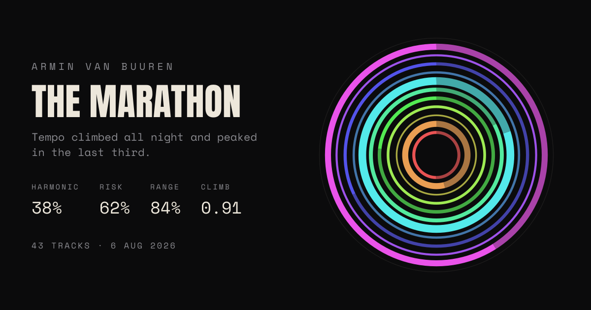

# Saber

A DJ drops an exported set history and gets back a visual, statistical portrait of what they
actually played: harmonic structure, energy climb, risk profile, and a named archetype.

It labels and describes. It does not score, rank, or roast anyone. See [CLAUDE.md](CLAUDE.md)
for the full spec — product rules, design system, data model, and build order.

Live at [saber.me](https://saber.me).



*A reading of a published 43-track set ([see it live](https://saber.me/example/asot-ibiza-2026)). Each ring is a key, its thickness is time spent in that key, and in the app the rings turn at the set's own tempo.*

## Status

The core loop is live: drop a file, read it, save it, publish it, delete it. Every build-order
step shipped except email claim, which turned out not to be needed — a signed cookie already
gives an uploader a private profile with no signup.

- [x] 1. Parser + key normalization (`lib/parse`)
- [x] 2. Metrics — the four readings and the archetypes (`lib/metrics`)
- [x] 3. Schema, RLS-equivalent ownership checks, anonymous sessions — Neon Postgres, not
      Supabase; see the note in `db/0001_init.sql` for why row level security isn't what's
      doing the authorization here
- [x] 4. Upload → result page, flat 2D rings
- [x] 5. Harmonic Rings in 3D, turning at the set's own tempo
- [x] 6. OG card, shared by a share link and an example's permalink
- [ ] 7. Email claim flow — not built. A signed cookie already gives an uploader a private
      profile with no login; email only buys cross-device access, and nobody's asked for that yet
- [ ] 8. The Helix — cut. Felt forced next to the rings; not revisited

Beyond the original build order:

- A tempo curve across the set, colored by key, sitting under Vitals
- Genre breakdown, weighted by time played
- A Beatport Top 100 matcher (`lib/beatport`) and a live daily mirror from a companion project's
  cron — see `lib/beatport/store.ts`
- Saved sets: a cookie-based profile (`/sets`) with no account, a wall of ring tiles, publish /
  unpublish, delete
- Downloadable share images for Stories and square posts, drawn to a real `<canvas>`
- A handful of named examples with their own permalinks (`/example/[id]`) and OG cards, so a
  stranger can see a real reading before dropping their own file
- Anonymous usage tracking (`set_reads`, `page_views`) — how many distinct browsers actually use
  the site, what they read, what pages they land on. No track titles, no PII; see the comments at
  the top of `db/0003_reads.sql` onward for exactly what is and isn't stored

## Layout

```
lib/parse/                Camelot / Open Key / classical -> Camelot; rekordbox .txt -> tracks
lib/metrics/               transitions, vitals (the four readings), archetypes, peak detection
lib/beatport/              matching a tracklist against a live Beatport Top 100 mirror
lib/ui/                    rings SVG, ring-split rules, tempo curve, share-image canvas drawing
lib/og/                    the shared OG card (used by share links and example permalinks)
lib/db.ts, lib/session.ts  Neon connection, signed cookies (set ownership + anonymous reader id)
lib/examples.ts            the list of published sets shown to a visitor with no file to hand

app/page.tsx                drop zone / result
app/set/[id]/                a saved set: publish, unpublish, delete
app/sets/                   the cookie-based profile
app/s/[code]/                a compact share link (readings + rings, not the tracklist)
app/example/[id]/            a named example's own permalink + OG card
app/api/                    sets (save/publish/delete), beatport-score, read + visit tracking

db/                         migrations, in order, each with a comment on what it's for and why
test/fixtures/rekordbox/     real and synthetic exports, plus an assembled large-set fixture
```

## Commands

```bash
npm run dev        # next dev
npm test           # vitest run
npm run typecheck  # tsc --noEmit
```

## Fixtures

`test/fixtures/rekordbox/euro-problem.txt` is a real rekordbox export (10 tracks, fully keyed) —
it is what proves the UTF-16LE decoding and header matching work against the actual format.
`asot-demo.txt` is a larger, assembled fixture (43 tracks) built from a published tracklist with
tempo and key looked up per track on Beatport; `test/fixtures/rekordbox/README.md` records exactly
how it was built and the two data decisions made along the way. The rest are synthetic, covering
Open Key notation, non-English headers, and sparse key data.

Adding a fixture from someone else's set means committing their tracklist to this repo. Only do
it with their say-so.

## Credit

The 3D visuals are adapted conceptually from Kenichi Yoneda's *Geom* (CC BY-SA 4.0) — built from
the concepts, not his shaders, and credited in the footer.
